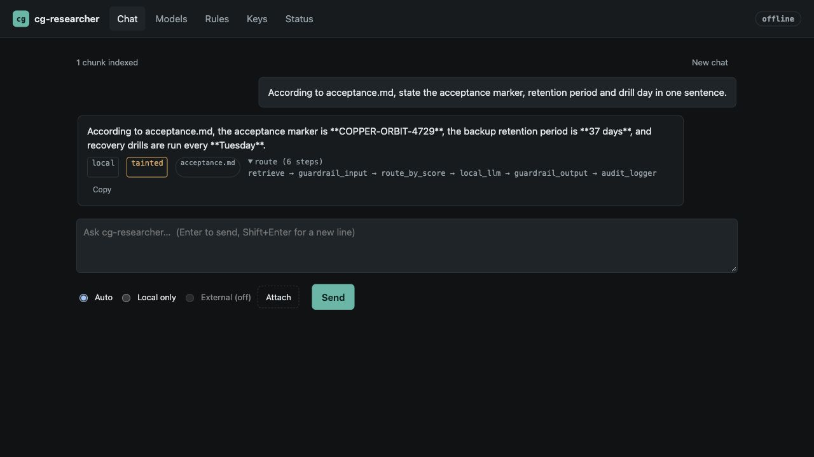
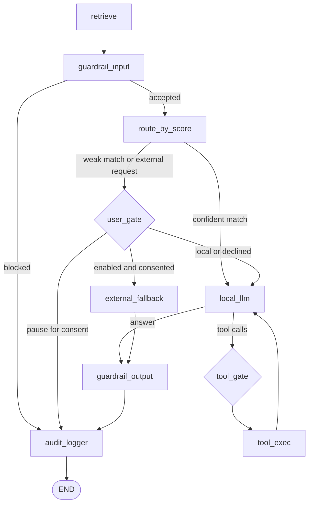

# CG LOCAL RESEARCHER

**Ask your files. Follow the sources. Choose what leaves your Mac.**

[](https://github.com/cgfixit/cg-researcher/actions/workflows/ci.yml)
[](https://github.com/cgfixit/cg-researcher/actions/workflows/ui-e2e.yml)


[](LICENSE)

A local-first research assistant in Rust: RAG over your own notes and documents, a loopback
model, and optional connectors for web search, mail, calendar and more. Use the terminal or an
embedded web UI; add Anthropic Claude or xAI Grok only when you explicitly enable and consent to it.

**The graph is the policy.** Every turn enters at `retrieve` and finishes at `audit_logger`;
tool permissions, external-model consent and write approval are enforced in code.
The shipped configuration is offline, loopback-only, external models off, connectors off.
No telemetry SDKs, hosted vector database or frontend CDN.

[Quickstart](#quickstart) · [Feature map](#feature-map) · [Policy graph](#policy-graph) ·
[User guide](docs/user-guide.md) · [Security](SECURITY.md) · [Invariants](INVARIANTS.md)



Real Ollama output over synthetic notes. See the [verification gallery](docs/screenshots/README.md)
for the exact build, exercised paths and limits.

## What you can do

- **Research your own material.** Find decisions in engineering notes, summarize runbooks, or ask
  questions about a project corpus with file references you can inspect.
- **Review a document in context.** Attach Markdown, text or Word documents; use a local vision
  model for PNG diagrams and screenshots.
- **Extend a local answer deliberately.** Enable web search or ask an external model for a
  specific turn, with separate controls over whether local context and attachments can leave.
- **Connect useful daily tools.** Search mail, check a calendar, inspect local network metadata,
  or propose a draft/event through connectors you enable. Approve write tools from the CLI.

Built for one operator on one Mac. The practical value is a searchable personal corpus,
local inference and inspectable decisions, with optional services behind explicit controls.

## Feature map

|Area               |What is implemented                                                                                         |Details                                      |
|-------------------|------------------------------------------------------------------------------------------------------------|---------------------------------------------|
|Local models       |OpenAI-compatible chat and embeddings; Ollama, LM Studio, llama.cpp, MLX and vLLM configurations            |[Models](#local-models)                      |
|Retrieval          |SQLite FTS5 BM25 + exact cosine search, RRF fusion, source references and live index reload                 |[Retrieval](#retrieval)                      |
|Attachments        |`.md`, `.txt`, `.docx` and `.png`; bounded parsing, PNG metadata stripping, optional local vision           |[User guide](docs/user-guide.md#everyday-use)|
|Web UI             |Local answer streaming, source chips, attachments, model switching/autotune, rules, keys, status and reindex|[Web UI](#web-ui)                            |
|Policy             |Ten-node graph, bounded tool loop, origin-aware permissions, protected context and per-turn external consent|[Graph and gates](#policy-graph)             |
|External models    |Anthropic Claude / xAI Grok; three gates, payload rules, budgets and no tools                               |[External models](#external-models)          |
|Connectors         |Web search, Gmail, Google Calendar, Telegram, Twilio SMS, 1Password metadata and network snapshots          |[Connector map](#connectors)                 |
|Research           |Multi-step local research jobs: planned sub-questions, per-step checkpoints, resume, cited report           |[User guide](docs/user-guide.md#long-form-research)|
|Audit and operation|HMAC-chained protobuf log, signed head, concurrent-writer locking, selftest, launchd and maintenance        |[Operation](#operation-and-verification)     |

See the [detailed feature inventory](docs/feature.md) for component status, and the
[verification evidence](docs/screenshots/integration/README.md) for what has actually run.

## Quickstart

Target: Apple Silicon (arm64), macOS 14 or newer. Install
Xcode Command Line Tools (`xcode-select --install`)
and native arm64 [rustup](https://rustup.rs). The installer rejects Rosetta shells;
`rustc -vV` should report `host: aarch64-apple-darwin`. Use rustup so the repository’s
pinned toolchain is honored.

```bash
git clone https://github.com/cgfixit/cg-researcher.git
cd cg-researcher
./scripts/install.sh
export PATH="$HOME/.cg-researcher/bin:$PATH"
```

Start your local model server, then edit `~/.cg-researcher/cg.toml`: set `llm.base_url`,
`llm.model` and `llm.embed_model` to models your server exposes. Set `llm.vision_model`
to an installed VLM, or `""` to disable image forwarding. Model weights are separate:
the installer does not download them, and the shipped text/vision IDs must exist on your server.

For Ollama with the default embedding model:

```bash
ollama pull all-minilm
cp ~/notes/*.md ~/.cg-researcher/corpus/
cg-researcher index
cg-researcher selftest
cg-researcher chat
```

In CLI chat: `/attach ./spec.docx`, `/attach ./diagram.png`, `/ext <question>`, `/clear`, `/quit`.
Open the browser interface with `cg-researcher app`, which starts or reuses `serve` and pairs the UI.
Alternatively, run `cg-researcher serve` in one terminal and `cg-researcher ui` in another.

|Install option                                                        |Purpose                                                                                          |
|----------------------------------------------------------------------|-------------------------------------------------------------------------------------------------|
|`./scripts/install.sh --service --maintenance`                        |Per-user launchd server + daily 03:15 local health check                                         |
|`./scripts/install.sh --with-netviewer`                               |Also build CyClaw-Net-Viewer at the installer-pinned commit                                      |
|`install.command` / `uninstall.command`                               |Finder entry points for the source install/uninstall scripts                                     |
|[Release artifacts](https://github.com/cgfixit/cg-researcher/releases)|Apple Silicon `.app` and universal CLI; see [binary installation](packaging/macos/CLI-INSTALL.md)|

App bundles are ad-hoc signed, not notarized; source installation is the supported path.
Intel and Linux are best-effort; Linux has no Keychain or launchd and the installer refuses it.
Windows is unsupported. Formerly `cg-agent`: see the [migration notes](docs/user-guide.md#install).

## Local models

The client uses OpenAI-compatible endpoints on loopback:

|Server                                    |Typical `llm.base_url`                |
|------------------------------------------|--------------------------------------|
|Ollama                                    |`http://127.0.0.1:11434/v1`           |
|LM Studio                                 |`http://127.0.0.1:1234/v1`            |
|llama.cpp `llama-server` / `mlx_lm.server`|`http://127.0.0.1:8080/v1`            |
|vLLM / another compatible server          |Its configured loopback `/v1` endpoint|

Shipped defaults: `qwen3.8:27b-mlx-cg` for text,
`gemma4-26b-a4b:ud-q4_k_xl-cg` for vision, and `all-minilm` for embeddings.
Choose models that fit your machine and backend. PNGs are validated and re-encoded;
they reach a model only when `llm.vision_model` is configured.

Autotune uses model metadata, with built-in fallbacks, to derive output-token, temperature,
RAG top_k and context-character budgets when models switch. An advertised context ceiling
can differ from the backend’s loaded allocation; check the server configuration too.
Non-loopback model URLs require an explicit `llm.allow_non_loopback = true` override in `cg.toml`.

## Policy graph

`cg-graph` is a small LangGraph-style `StateGraph`; policy lives in
`cg-core::agent`. Ten nodes, four routers, one entry and one audit sink:



**`user_gate`: may this turn use an external model?** The client is constructed only when
`app.mode = "hybrid"` and `external.enabled = true`; each query still needs consent.
Without consent, an eligible turn returns `needs_confirm = true` and is audited. The client
re-sends with `confirm_online`; no graph checkpoint or waiting thread is retained.

**`tool_gate`: may this specific tool call run?** Arguments must be a JSON object and the
tool must have been offered to this origin. Allowed reads run; write handling depends on the channel:

|Origin        |Write-tool behavior                                                                                       |
|--------------|----------------------------------------------------------------------------------------------------------|
|CLI `chat`    |Human confirmation by default. Explicit auto-approval applies only to CLI turns without untrusted context.|
|HTTP / web UI |Writes are denied, including when `tools.auto_approve_writes = true`.                                     |
|Telegram / SMS|Write tools are never offered and cannot be approved. Read tools are restricted to `remote_ok` by default.|

Corpus text included in a prompt, attachments, untrusted tool output and external answers mark a
turn tainted internally; the UI calls this Protected context. Such turns cannot auto-approve
writes. Denied/declined calls return `DENIED: <reason>` to the model, and decisions enter the
audit chain with argument fingerprints. The local tool loop is bounded by `max_tool_iterations`.

See [I1–I8 and their enforcing tests](INVARIANTS.md) and the [threat model](SECURITY.md#threat-model-single-operator-own-mac).

## External models

Off by default. Anthropic Claude and xAI Grok require all three gates:

1. `app.mode = "hybrid"`.
2. `external.enabled = true`.
3. Consent for the query: CLI confirmation, `/ext`, the UI’s External mode, or an explicit API request.

SMS can never consent; Telegram requires its opt-in external-consent policy and confirmation flow.
External models never receive tools. Model IDs must match the selected provider.

- **Payload controls:** local RAG context, attachment text and images stay local under the shipped
  external rules. Outbound text is redacted and capped at 24,000 characters.
- **Budgets:** 20 calls/hour, 100/day and 2,048 output tokens by default. Call budgets are in memory
  and reset on process restart. UI rule relaxations require acknowledgement and a `policy_relaxed` audit record.
- **Keys:** the UI stores provider keys in macOS Keychain; config holds secret references and no API
  endpoint returns a stored key.
- **Transport:** pinned provider hosts, TLS 1.3 only and Mozilla roots by default. `external.tls_roots = "system"`
  is a config-file opt-in; see [TLS behavior and limits](SECURITY.md#transport-tls).

External-model consent and connector enablement are separate controls. Enabled connectors make
their own service requests; remote services’ privacy and retention policies apply.

## Web UI

Chat · Models · Rules · Keys · Status, compiled into the binary with no CDN or remote assets.
Chat includes attachments, source chips, Copy, New chat, progress feedback and guarded local-answer
streaming. Status shows the graph, budgets and audit verification, and can reindex the corpus.

The launcher authenticates its server using a nonce/HMAC exchange before obtaining a single-use
pairing code (120-second TTL). The code travels in the URL fragment, is scrubbed from history,
and becomes a 12-hour session token in `sessionStorage`; restart invalidates sessions.
The permanent API key is never sent by the launcher.

The HTTP surface checks loopback Host headers and Origin, serves a strict CSP, and restricts settings
to a whitelist. UI changes cannot enable connectors, change bind/loopback policy or grant write approval.
Overrides live in owner-only `~/.cg-researcher/ui-settings.toml`, layered over `cg.toml`.

Local SSE deltas pass the output guard before leaving the process; a tool round can reset provisional
text, and the final event is authoritative. CLI and external-model answers do not stream.
See [everyday use and API behavior](docs/user-guide.md#everyday-use) and [UI security](SECURITY.md#web-ui-threat-model).

## Retrieval

One owner-only SQLite file: `~/.cg-researcher/index/rag.sqlite3`.
FTS5 BM25 ranks keywords; an in-memory Rust scan ranks unit-normalized embeddings by
exact cosine; RRF (k = 60) combines the lists. No vector service, ANN index or SQLite extension.
Exact search cost grows with corpus size and embedding dimension; large-corpus latency needs measurement.

The corpus accepts `.md`, `.txt` and `.docx`; symlinks are ignored and document extraction is bounded.
Questions are tokenized and quoted before FTS5 matching. Re-run `cg-researcher index` after corpus
or embedding-model changes; a running server picks up the rebuilt index. Missing/unusable embeddings
leave keyword retrieval available; dimension mismatches warn and use keyword-only search.

## Connectors

Every connector ships with `enabled = false`. Enable only what you need in
`cg.toml`, supply secret references, then run `cg-researcher selftest`.

|Connector    |Tools / role                      |Controls and limits                                                                                                                                                            |
|-------------|----------------------------------|-------------------------------------------------------------------------------------------------------------------------------------------------------------------------------|
|`fetch_page` |`fetch_page`                      |One page as text, only from the exact hosts listed in cg.toml; HTTPS, no redirects, 2 MiB cap, untrusted output, not offered to remote origins.|
|`web_search` |`web_search`                      |SerpAPI; public Google only with no resolved key and explicit opt-in. No switch to public Google after API rejection/quota failure; CAPTCHA/rate limits cause refusal/cooldown.|
|`netconnect` |`net_neighbors`, `net_connections`|Allowlisted private/loopback IPv4 ranges; OS ARP cache and optional CyClaw-Net-Viewer socket snapshot on macOS.                                                                |
|`telegram`   |Inbound gateway                   |Private DMs, numeric user-ID allowlist, optional confirmation codes.                                                                                                           |
|`sms`        |Twilio polling gateway            |E.164 allowlist + PIN, lockout, processed inbound messages deleted; no public webhook.                                                                                         |
|`gmail`      |Search, read, create draft, send  |Reads are untrusted; writes use the CLI gate. Single recipient, header-injection checks, complete bounded confirmation body with secret redaction.                             |
|`gcal`       |List / create events              |Reads are untrusted; creation uses the CLI gate. No attendees field.                                                                                                           |
|`onepassword`|`onepassword_search`              |`op item list` metadata only: title, vault, category, URLs; no secret-value retrieval tool.                                                                                    |

Gmail/Calendar use `cg-researcher google-auth` for loopback PKCE authorization.
Telegram/SMS require non-empty allowlists. See [connector setup](docs/user-guide.md#connectors)
and [service-specific security limits](SECURITY.md#known-weaknesses-accepted-documented).
Adding a connector means one module with `async fn build(&Ctx) -> Parts` and one registry entry in
`cg-connectors`; core never depends on connectors.

## Operation and verification

`cg-researcher maintain` runs `selftest`, including audit-chain verification, records the outcome and
exits non-zero on failure. `install.sh --maintenance` schedules it daily at 03:15 local via launchd.
Audit records use protobuf + HMAC-SHA256 chaining, a signed head and a cross-process append lock.
Queries, senders and tool arguments are keyed fingerprints. See [audit limits](SECURITY.md#known-weaknesses-accepted-documented).

CI defines macOS build/test/Keychain/install checks, lint and documentation-command checks,
Chromium + WebKit UI tests against a real server with a mock model, a 70% line-coverage floor,
dependency/secret/workflow scans and bounded fuzzing. Current results are in
[Actions](https://github.com/cgfixit/cg-researcher/actions).

### Scheduled jobs

The GitHub jobs below are real `schedule:` triggers in `.github/workflows/` and run from `main`
without anyone starting them. GitHub can start a scheduled run late (an hour is not unusual), and
it pauses schedules in a public repository after 60 days without activity. The local job exists only
on a Mac where you ran `install.sh --maintenance`; nothing local is scheduled by default.

|What                                                                       |When                                                |Where                                                                            |
|---------------------------------------------------------------------------|----------------------------------------------------|---------------------------------------------------------------------------------|
|`cg-researcher maintain` (selftest + audit verify), **opt-in**              |daily 03:15 local                                   |launchd `com.cgfixit.cg-researcher.maintenance` via `install.sh --maintenance`   |
|gitleaks rescan of every branch and tag                                    |Mon 05:23 UTC                                       |`.github/workflows/gitleaks.yml`                                                 |
|actionlint + zizmor + shellcheck + uninstall test                          |Mon 05:29 UTC                                       |`.github/workflows/workflow-lint.yml`                                            |
|cargo-audit + cargo-deny                                                   |Mon 06:17 UTC                                       |`.github/workflows/audit.yml`                                                    |
|CI on macOS (build, test, Keychain, install smoke)                         |Mon 07:41 UTC                                       |`.github/workflows/ci.yml`                                                       |
|fuzz `attachments`, `sanitizer`, `stream`                                  |Tue 04:47 UTC                                       |`.github/workflows/fuzz.yml`                                                     |
|nightly `.app` + CLI prerelease when `main` has no `v*` tag or release yet |daily 09:07 America/New_York (crons 13:07, 14:07 UTC)|`.github/workflows/release.yml`; `gate` keeps the cron that is 09:07 in New York |

launchd is preferred on macOS because it runs a missed job once after wake. If you prefer cron anyway:

```cron
15 3 * * * $HOME/.cg-researcher/bin/cg-researcher --home $HOME/.cg-researcher maintain >> $HOME/.cg-researcher/logs/maintenance.log 2>&1
```

### Releases and acceptance

[Documented native acceptance](docs/screenshots/integration/README.md) covers real Ollama, CLI,
Safari corpus/attachment answers, pairing, policy controls, audit and local arm64 app packaging on
the identified integration build. That run used keyword-only retrieval; semantic retrieval,
vision inference, live authenticated third-party integrations, real Keychain mutation,
launchd installation and downloaded-app Gatekeeper acceptance were outside its coverage.

Tagged v* runs publish a public GitHub Release immediately. Manual `workflow_dispatch` (no inputs) and the
09:07 America/New_York schedule publish unreviewed `nightly-YYYYMMDD-<sha7>` prereleases and do not mark
them Latest. The schedule cuts one when main's tip has no `v*` tag and no complete release for that
commit; a previous green artifact-only run does not count. Re-running dispatch on a SHA that already
has a complete auto release skips the rebuild. See `.github/workflows/release.yml`.
Uninstall keeps your data; `--purge` requires typing `delete` before deleting the app home and Keychain items.

<details>
<summary><strong>Command reference</strong></summary>

|Command                            |Purpose                                                                             |
|-----------------------------------|------------------------------------------------------------------------------------|
|`init [--force-config]`            |Create owner-only home, config and secrets; `--force-config` restores shipped config|
|`chat`                             |CLI turn loop and interactive write approval                                        |
|`serve [--no-gateways]`            |Loopback API + UI at `127.0.0.1:8797`; enabled gateways unless suppressed           |
|`app`                              |Initialize if needed, start/reuse server, open paired UI                            |
|`ui [--print]`                     |Pair with a running server; optionally print the URL                                |
|`index`                            |Rebuild the corpus index                                                            |
|`research "<q>"` / `--resume <id>`  |Long-form research job with saved steps; local only, no writes                      |
|`selftest` / `maintain`            |Check configuration/runtime; record scheduled maintenance outcome                   |
|`audit verify` / `audit tail -n 20`|Verify the chain / inspect recent records                                           |
|`gateways`                         |Run Telegram/SMS gateways only                                                      |
|`google-auth`                      |Authorize enabled Gmail/Calendar connectors                                         |
|`netviewer [--cli]`                |Open Net-Viewer or print a numeric socket snapshot                                  |

```bash
curl -s http://127.0.0.1:8797/query \
  -H "authorization: Bearer $(cat ~/.cg-researcher/secrets/api.key)" \
  -H 'content-type: application/json' \
  -d '{"query":"What do my notes say about recovery testing?"}'
```

The [user guide](docs/user-guide.md) covers setup, migration, troubleshooting and the streaming API.

</details>

## Development

Start with [CLAUDE.md](CLAUDE.md), the contributor manual, and
[I1–I8](INVARIANTS.md), which map security rules to enforcing tests.
An invariant change needs a test and a [SECURITY.md](SECURITY.md) note.

```bash
./init.sh                     # developer bootstrap: locked deps, fmt, clippy, tests, init
./scripts/lint.sh             # shared local/CI lint gate
cargo test -p cg-researcher --locked docs_cli
```

Use a throwaway home for runtime experiments. The workspace forbids `unsafe`; clippy runs with
`-D warnings`. Repository skills cover verification, invariants, closed defaults, runtime smoke,
optimization and platform gotchas; see the [skills index](.claude/skills/README.md).

<details>
<summary><strong>Workspace and toolchain</strong></summary>

|Path                                     |Responsibility                                                               |
|-----------------------------------------|-----------------------------------------------------------------------------|
|`crates/cg-graph`                        |Generic StateGraph, conditional edges, bounded invocation                    |
|`crates/cg-core`                         |Policy graph, config, RAG, models, guards, egress, tuning, secrets           |
|`crates/cg-audit`                        |Chained protobuf log, signed head, concurrent append                         |
|`crates/cg-connectors`                   |Tools, gateways and third-party integrations                                 |
|`crates/cg-researcher`                   |CLI, loopback HTTP server and embedded `ui/`                                 |
|`config/`, `packaging/macos/`, `scripts/`|Defaults, app packaging and operational scripts                              |
|`e2e/`, `fuzz/`                          |Playwright Chromium/WebKit specs and attachment/sanitizer/stream fuzz targets|

- `rust-toolchain.toml`: Rust 1.99.1, rustfmt and clippy via rustup.
- `Cargo.toml`: edition 2024, MSRV 1.90, centralized dependency versions; committed lockfile and `--locked` builds.
- `deny.toml`: license/source checks and bans on telemetry SDKs, OpenSSL and native-tls.
- HTTP uses reqwest/rustls; SQLite is bundled with FTS5; prost/protox avoid a `protoc` dependency;
  macOS Keychain uses Security.framework. Playwright and fuzz dependencies have their own lockfiles.

See [contributor commands](CLAUDE.md#commands) for full test, coverage, fuzz and browser workflows.

</details>

## License

MIT, see [LICENSE](LICENSE). Portions derive from [waku-agent](https://github.com/ShenSeanChen/waku-agent)
(MIT, Sean Chen) and from CyClaw / CG-agent-harness / CyClaw-Net-Viewer by the same copyright holder as
this repository; the attribution in `LICENSE` stays with any redistribution.