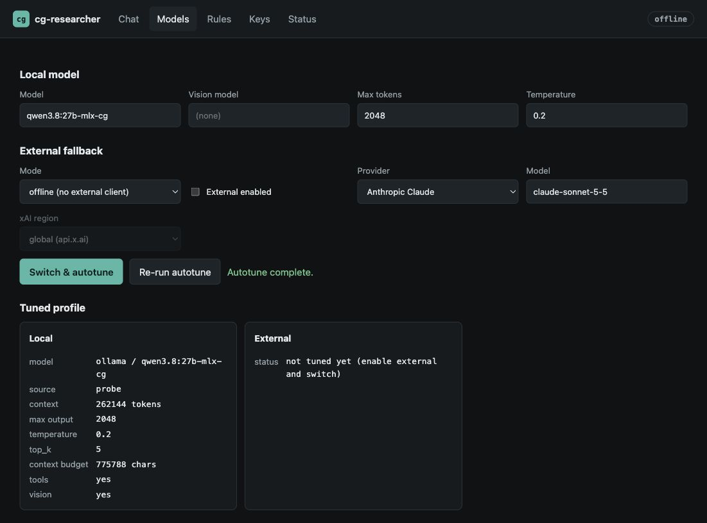
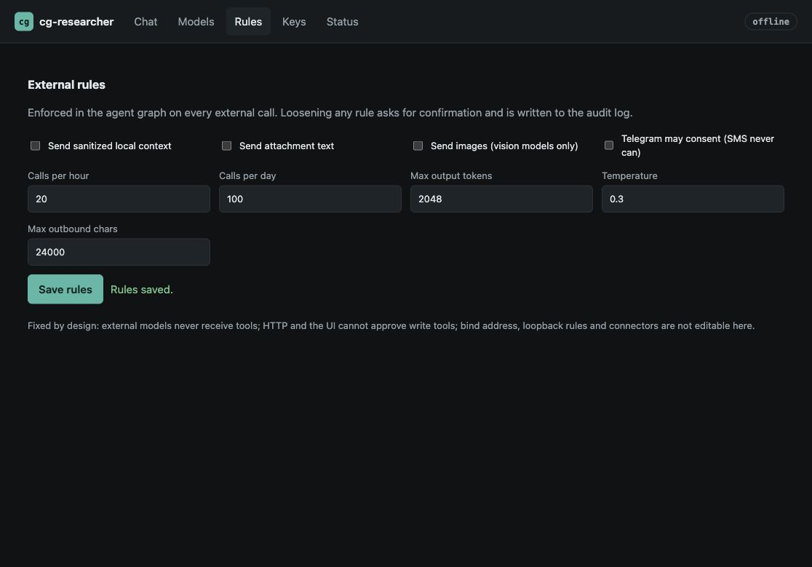
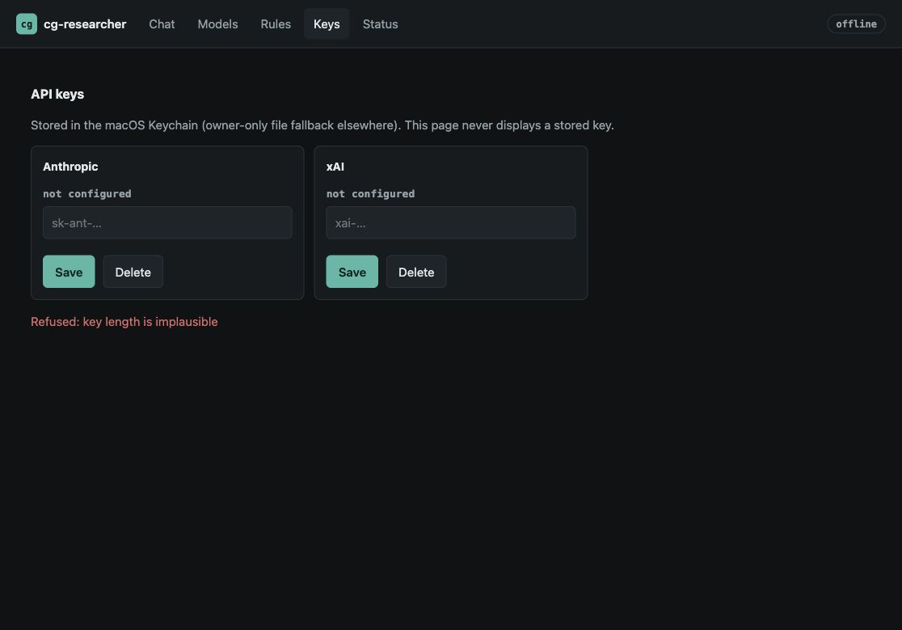
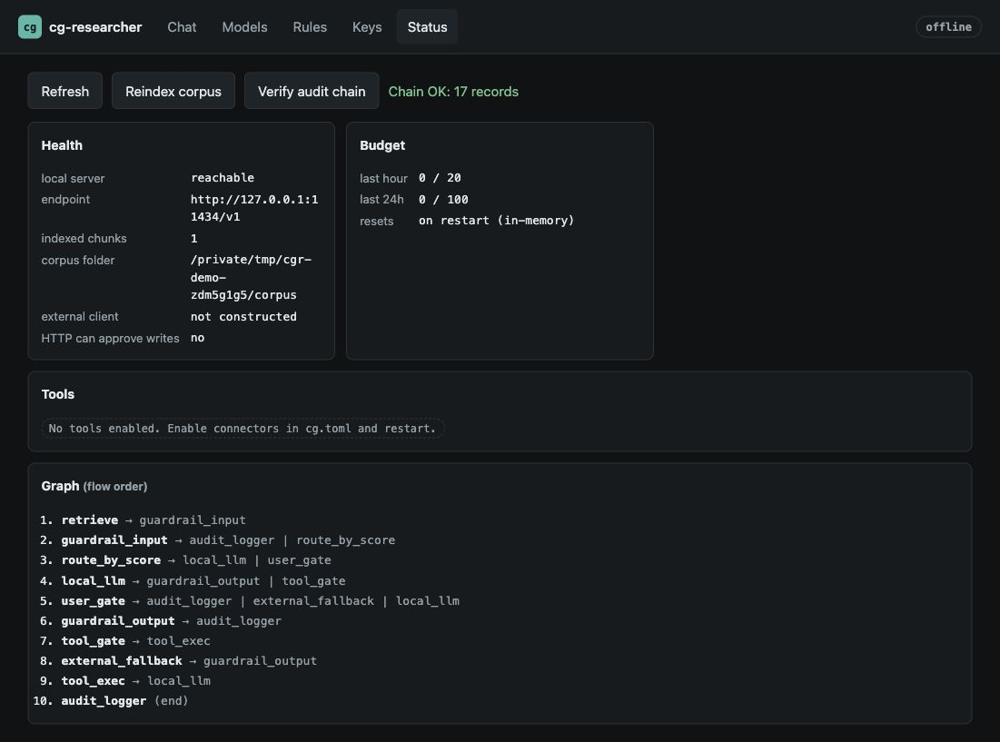
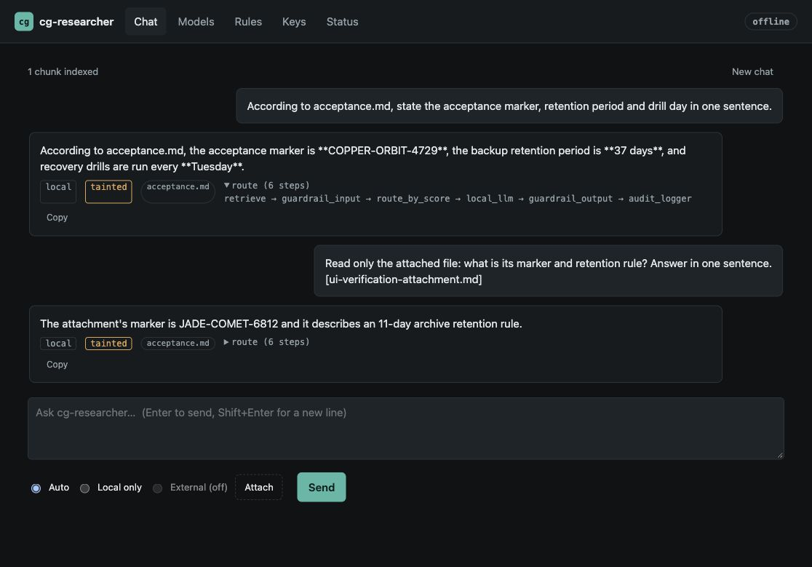
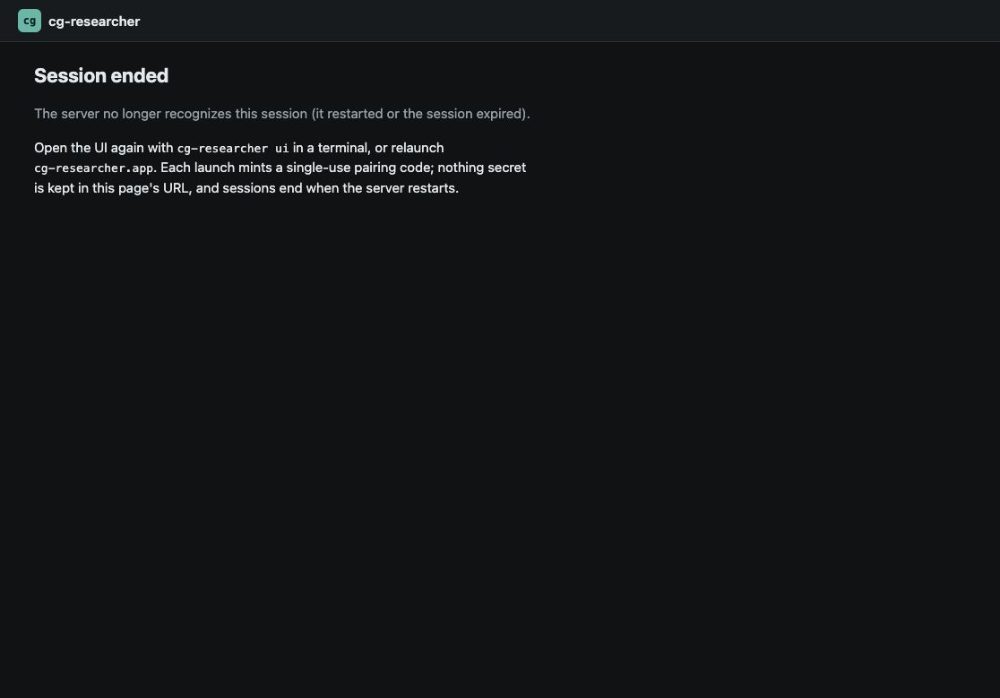

# Browser verification screenshots

Captured on macOS with Computer Use on 2026-10-24 from PR #31 source
`c7b00b8964e5150485a87d334813711438a224e5`, including main's merged write
approval fix (#26). These are actual browser captures, using a disposable
application home and synthetic corpus/attachment data. No screenshot contains
an API key, pairing fragment, or real user document.

The branch-specific debug binary was built with pinned Rust 1.99.1 using
`cargo build --locked -p cg-researcher`. Its SHA-256 was
`b30aabf1f087f7e2a20f89b4f267e03ccc0acf8222a31e8c0a34e44a948c20ff`.
The gallery commit changes documentation only; it does not change that binary's
production source. The browser used loopback port 19038; generation used real
Ollama at `http://127.0.0.1:11434/v1`, model `qwen3.8:27b-mlx-cg`
(model digest `c4472360741adbd8757713b465fb169f2af2927cd6756998f9b8f33652330196`).

A subsequent review fix maps wildcard bind addresses to loopback for launcher
connections (`ui` and `app`), without changing the server bind or egress policy.
Before the fix, an actual `ui --print` invocation with an explicitly permitted
`0.0.0.0` configuration failed with `scheme http not allowed`. After rebuilding,
the same command succeeded against the disposable loopback server and the browser
completed pairing and scrubbed the fragment. A focused regression covers IPv4/IPv6
wildcards, preservation of specific addresses, and invalid input. The seven images
remain captures of the source revision above; they were not recaptured after this
launcher-only change.

## Gallery

### 1. Real corpus answer and taint propagation

The answer correctly returns COPPER-ORBIT-4729, 37 days, and Tuesday from the
synthetic corpus. The source, taint marker, and expanded execution route are visible.

### 2. Model configuration and live autotune

Re-run autotune completes with external generation disabled. The displayed
262,144-token context is the model's advertised ceiling; Ollama's observed loaded
allocation was 32,768 tokens. This screenshot does not establish a 262k runtime
budget or successful vision inference.

### 3. Policy settings

Saving the rules succeeds. External context, attachments, images, and Telegram
consent remain disabled; the UI states that HTTP cannot approve write tools.

### 4. Invalid key rejection

Submitting the synthetic string `invalid` is refused before storage. Both providers
remain unconfigured. Real key storage/deletion was not exercised.

### 5. Health and audit integrity

The actual Ollama endpoint is reachable, one chunk is indexed, no external client
is constructed, HTTP write approval is disabled, and the audit chain verifies
with 10 records at this check.

### 6. Actual file attachment

A synthetic Markdown file was selected through the browser's file chooser. Real
Qwen returns its distinct marker JADE-COMET-6812 and 11-day retention rule,
demonstrating that the answer uses the attachment rather than repeating corpus facts.

### 7. Restart invalidates the browser session

After restarting only the disposable server, Refresh rejects the old session and
the UI displays its recovery instructions. This is an actual restart, not a
manually altered browser session or fixture response.

## Verification coverage

| Path | Evidence and result |
| --- | --- |
| Current-head build and pairing | Rust 1.99.1 build passed; `cargo test --locked -p cg-researcher pairing`: 2 passed, including proof/challenge rejection and single-use session compatibility. |
| Real provider and retrieval | Current-head init/index/serve/ui, corpus answer, attachment answer, autotune, rules save, invalid-key rejection, audit verification and restart invalidation passed through actual code/browser paths. |
| Earlier candidate UI controls | At `40e5f3a`, model validation, provider selection, applying/restoring temperature, policy tightening, cancelling/accepting policy relaxation, status refresh/reindex, copying an answer and New chat were exercised. These earlier checks are not relabeled as reruns at the latest head. |
| Earlier security probes | Fake-listener rejection without transmitting the permanent key, IPv6 pairing, and 401/421/403 authentication/Host/Origin probes passed. See the PR for exact scoped test commands and revisions. |
| Retrieval limitation | `all-minilm` was absent (404). Indexing produced one chunk and zero embeddings; successful answers used keyword-only retrieval. Semantic retrieval remains unverified. |
| Web search | In a separate disposable home, both the production connector and real Qwen tool call reached Google's CAPTCHA/consent refusal. The UI reported `web_search:error`; successful search results were not verified. SerpAPI credentials were absent. |
| Native/package distinction | Earlier native Safari verification used a mock model. These screenshots show the in-app browser with real Ollama; they do not prove packaged `.app` or native WebView acceptance. |
| Hosted CI | At `c7b00b8`, jobs failed/cancelled/skipped without execution. Workflow-lint annotations state that account payments/spending limits prevented jobs starting. This is not passing CI. |

Live Anthropic/xAI, authenticated Gmail/Calendar/Telegram/SMS/1Password,
external write effects, vision inference, real Keychain mutation, launchd,
destructive uninstall/purge and signed release acceptance were not verified by
this gallery. They require credentials or separate platform fixtures. Focused
branch checks for uninstall, previews and workflow fixes remain separate evidence.
Do not treat these screenshots as an assertion that every product feature passed.
